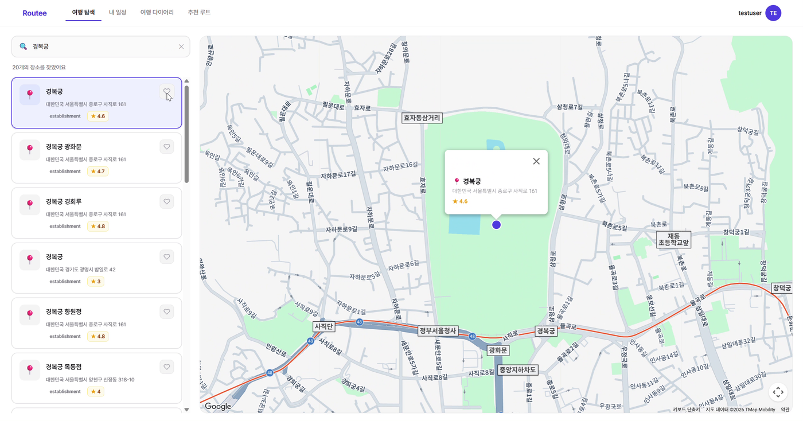
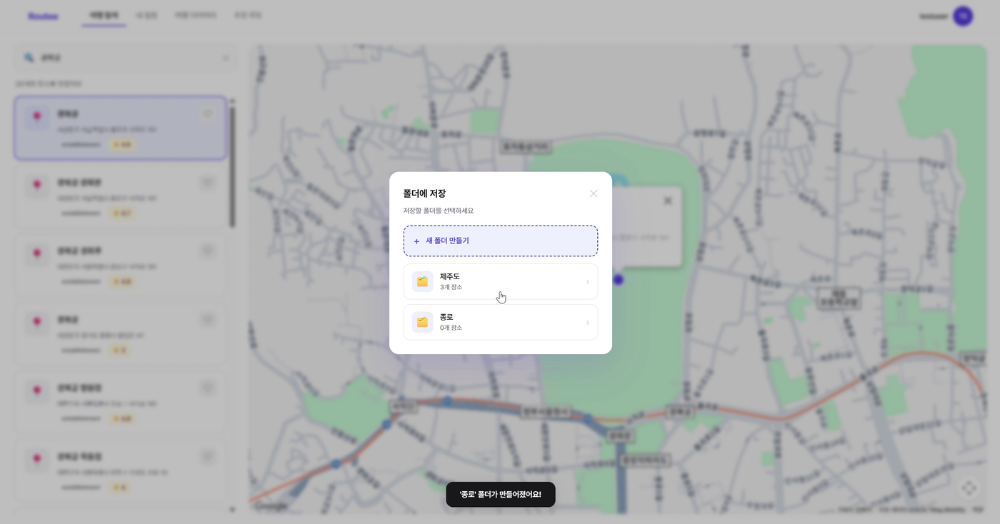
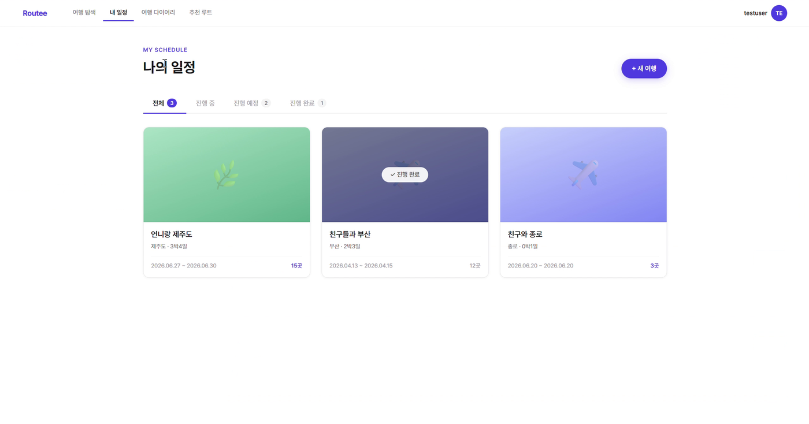
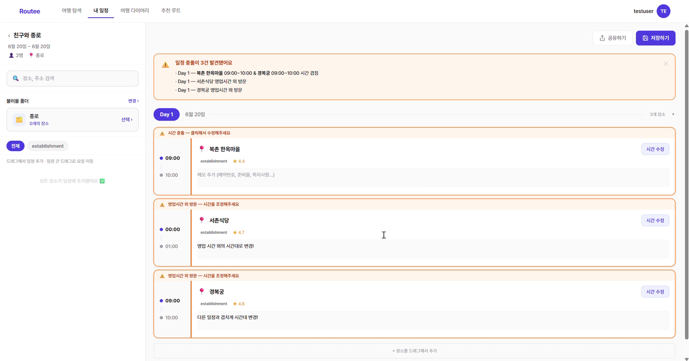
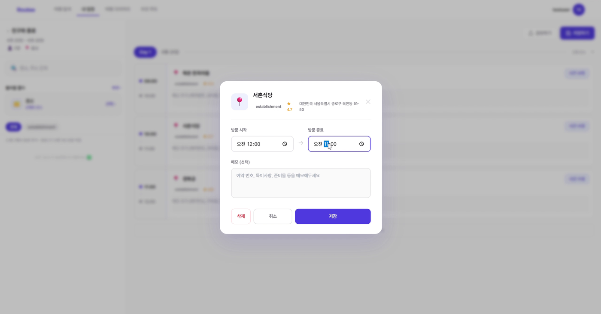
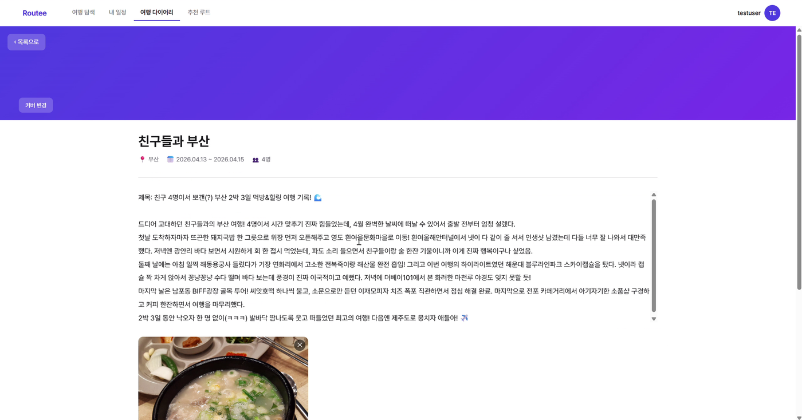

# Routee

여행지를 검색해 마음에 드는 장소를 폴더에 모아 두고, 날짜별 타임라인으로 여행 일정을 짜는 여행 일정 관리 웹 서비스입니다.
일정에 넣은 장소의 영업시간과 방문 시간이 맞지 않거나 같은 날 일정끼리 시간이 겹치면 충돌을 알려 주고,
여행이 끝난 뒤에는 일정별로 여행 다이어리를 남길 수 있습니다.

Spring Boot 백엔드와 React 프론트엔드를 모두 구현한 풀스택 프로젝트입니다.

## 개요

| 항목 | 내용 |
| --- | --- |
| 기간 | 2026.03 ~ 2026.06 |
| 인원 | 1명 (개인 프로젝트) |
| 담당 | 기여도 100%<br>- 백엔드 API 설계 및 구현 (인증, 장소, 폴더, 일정, 타임라인, 다이어리)<br>- 일정 충돌 감지 (영업시간, 시간 겹침)<br>- Google Places API 연동 및 장소 데이터 캐싱<br>- DB 설계, React 프론트엔드 구현 |

## 기술 스택

| 분류 | 기술 |
| --- | --- |
| Backend | Java 21, Spring Boot 3.5, Spring Data JPA, Spring Security, OAuth2 Client, WebClient |
| Auth | JWT (jjwt), Google 소셜 로그인 |
| Database | MySQL |
| Frontend | React 19, TypeScript, Vite, Tailwind CSS, React Router, Axios |
| External API | Google Places API, Google Maps JavaScript API |
| Tool | IntelliJ IDEA, VS Code, Git, GitHub |

## 주요 기능

- 회원가입/로그인: 아이디/비밀번호 로그인, Google 소셜 로그인, JWT 인증
- 장소 탐색: Google Places로 장소를 검색해 지도에서 확인하고, 마음에 드는 장소를 폴더에 저장
- 폴더: 장소를 주제별 폴더로 모아 관리
- 일정 만들기: 여행지, 기간, 인원으로 일정을 만들고 장소를 임시 보관함에 담은 뒤 날짜별 타임라인으로 배치
- 타임라인 편집: 드래그로 방문 순서 변경, 방문 시간과 메모 수정
- 충돌 알림: 영업시간 밖 방문이나 같은 날 일정끼리 시간이 겹치면 경고 표시
- 여행 다이어리: 일정마다 다이어리 1개 작성 (본문, 대표 이모지, 커버 색상, 사진)

## 프로젝트 구조

```
Routee
├── routee-backend                 Spring Boot
│   └── src/main/java/com/routee
│       ├── auth                   회원가입, 로그인, Google OAuth2, JWT
│       ├── schedule               일정, 타임라인, 임시 보관함, 장소 검색, 충돌 감지
│       ├── folder                 장소 폴더
│       ├── diary                  여행 다이어리
│       └── global                 Security 설정, JWT 필터, WebClient, 예외 처리
├── routee-frontend                React + TypeScript
│   └── src
│       ├── pages                  로그인, 탐색, 일정 목록/상세, 다이어리, 마이페이지
│       ├── components             공통 컴포넌트, 레이아웃
│       ├── api                    Axios 클라이언트, API 함수
│       └── store                  로그인 상태 관리 (Context)
└── docs                           DB 구조 문서
```

## 데이터베이스

```
users ─┬─ folders ── folder_places ── places
       ├─ schedules ─┬─ schedule_tmp_places ── places
       │             ├─ timeline_items ─────── places
       │             └─ diaries
       └─ diaries
```

| 테이블 | 설명 |
| --- | --- |
| users | 회원 정보, 로그인 방식(자체/Google) |
| places | Google Places에서 가져온 장소 정보 캐시 (좌표, 평점, 영업시간 JSON) |
| folders, folder_places | 사용자가 만든 장소 폴더와 폴더에 담긴 장소 |
| schedules | 여행 일정 (제목, 여행지, 인원, 기간) |
| schedule_tmp_places | 일정에 배치하기 전 장소를 담아 두는 임시 보관함 |
| timeline_items | 날짜별 방문 장소 (방문 순서, 시작/종료 시간, 메모, 충돌 여부) |
| diaries | 일정별 여행 다이어리 (일정당 1개) |

- 같은 장소가 폴더나 보관함에 중복으로 담기지 않도록 `(folder_id, place_id)`, `(schedule_id, place_id)`에 유니크 제약을 두었습니다.
- 회원이나 일정을 삭제하면 하위 데이터가 함께 삭제되도록 외래키에 `ON DELETE CASCADE`를 설정했습니다.

전체 테이블 정의는 [DB 구조 문서](./docs/Routee%20DB%20구조%20.pdf)와 [schema.sql](./routee-backend/src/main/resources/db/schema.sql)에 있습니다.

## 구현 내용

### 1. 일정 충돌 감지

타임라인 항목의 방문 시간을 바꿀 때마다 두 가지 충돌을 검사해 `conflict_warning`에 저장합니다.

- **영업시간 충돌:** Google Places의 영업시간 데이터(요일별 open/close)를 기준으로 방문 시간이 영업시간 밖이면 충돌로 판단
  - 자정을 넘겨 영업하는 경우(예: 22:00 ~ 02:00)와 `2400` 표기, 24시간 영업(close 정보 없음)도 처리
  - 영업시간 정보가 없거나 형식이 맞지 않으면 충돌 없음으로 처리해, 데이터 문제로 일정 저장이 막히지 않도록 함
- **시간 겹침:** 같은 날의 다른 항목과 `A.시작 < B.종료 && B.시작 < A.종료`이면 겹침으로 판단
- 한 항목의 시간이 바뀌면 같은 날 다른 항목의 충돌 여부도 달라질 수 있어, 수정하거나 삭제할 때 같은 날 항목 전체의 충돌 여부를 다시 계산

### 2. 장소 검색과 캐싱

- Google Places Text Search로 장소를 검색하고, 이미 DB에 저장된 장소는 내부 ID를 함께 반환
- 장소를 저장할 때 DB에 없는 장소만 Place Details API로 상세 정보(영업시간, 전화번호, 평점 등)를 조회해 `places` 테이블에 저장하고, 이미 있는 장소는 DB에서 바로 가져와 외부 API 호출을 줄임

### 3. 일정과 타임라인

- 일정 생성, 수정, 삭제와 내 일정 목록 조회
- 장소를 임시 보관함에 담고, 보관함에서 원하는 날짜의 타임라인으로 옮기는 흐름으로 일정 구성
- 폴더에 모아 둔 장소를 한 번에 임시 보관함으로 가져오기
- 드래그로 바꾼 순서를 한 번에 저장하는 순서 변경 API
- 일정, 폴더, 타임라인 항목마다 요청한 사용자의 소유인지 확인하는 권한 검증

### 4. 인증

- 아이디/비밀번호 회원가입과 로그인, Google OAuth2 로그인
- 로그인에 성공하면 JWT를 발급하고, `JwtAuthFilter`가 요청마다 토큰을 검증하는 세션 없는(STATELESS) 구조
- `@RestControllerAdvice`로 잘못된 요청의 예외를 400 응답으로 통일

### 5. 프론트엔드

- 로그인, 장소 탐색(지도), 일정 목록, 일정 상세(타임라인), 다이어리, 마이페이지 화면 구현
- 일정 상세 화면에서 보관함의 장소를 드래그해 타임라인에 넣고, 타임라인 안에서 드래그로 순서 변경
- 충돌이 있는 항목은 영업시간 충돌인지 시간 겹침인지 구분해 경고 표시
- Axios 클라이언트로 API 호출 시 JWT를 함께 전송하고, 로그인하지 않은 사용자는 로그인 화면으로 이동

- ## 시연 영상

[](https://youtu.be/3UlXkVGbSTc)

  ## 화면

| 장소 탐색 | 폴더에 장소 저장 |
| --- | --- |
|  |  |

| 내 일정 목록 | 타임라인 충돌 알림 |
| --- | --- |
|  |  |

| 방문 시간 수정 | 여행 다이어리 |
| --- | --- |
|  |  |

## 실행 방법

### Backend

1. MySQL에 `routeedb` 데이터베이스 생성
2. `routee-backend/src/main/resources/application-secret.yaml` 작성 (보안을 위해 레포에는 포함하지 않음)
   - Google OAuth 클라이언트 ID/Secret, JWT 비밀키
3. 환경 변수 `DB_USERNAME`, `DB_PASSWORD`, `GOOGLE_MAPS_API_KEY` 설정 후 실행

```bash
cd routee-backend
./gradlew bootRun
```

### Frontend

1. `routee-frontend/.env.local`에 환경 변수 설정

```
VITE_API_BASE_URL=http://localhost:8080
VITE_GOOGLE_MAPS_API_KEY=
```

2. 실행

```bash
cd routee-frontend
npm install
npm run dev
```

## 회고

- 일정 충돌을 판단하면서, 외부 API의 데이터 형식(자정을 넘기는 영업시간, `2400` 표기, 누락된 값)을 하나씩 확인하고 예외 상황을 처리하는 것이 중요하다는 것을 배웠습니다.
- 한 데이터의 변경이 다른 데이터의 상태에 영향을 줄 수 있다는 점을 고려해, 수정한 항목뿐 아니라 관련 항목 전체를 다시 계산하도록 설계했습니다.
- Google Places API에는 영업시간 정보가 아예 없거나 일부 요일만 등록된 장소가 있어, 이런 장소는 충돌 여부를 정확히 판단하기 어려웠습니다. 다음에는 사용자가 영업시간을 직접 입력하거나 수정할 수 있도록 하고, 영업시간 정보가 없는 장소는 화면에 따로 안내해 사용자가 직접 확인할 수 있도록 개선하고 싶습니다.
- 백엔드와 프론트엔드를 모두 구현하며 API 응답 구조를 화면에서 쓰기 편한 형태로 설계하는 것이 개발 속도에 큰 영향을 준다는 것을 느꼈습니다.
- 아쉬운 점은 다이어리 사진을 base64로 DB에 저장한 것입니다. 사진이 많아지면 DB 용량과 조회 속도에 부담이 되어, S3 같은 파일 저장소로 옮기고 URL만 저장하도록 개선하고 싶습니다.
